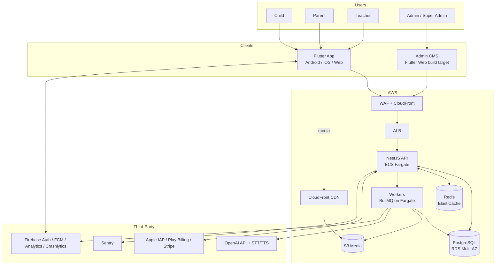

# 1. System Architecture

## 1.1 Architecture Style

- **Client**: single Flutter codebase → Android, iOS, Web. Offline-first; the app is fully usable for downloaded content without a network.
- **Backend**: NestJS **modular monolith** with strict module boundaries (each module owns its tables, exposes a TypeScript interface, never imports another module's repositories). Any module can be lifted into a microservice later without API changes because all cross-module calls go through injected service interfaces and domain events.
- **Async work**: BullMQ on Redis (transcoding callbacks, report generation, AI jobs, sync fan-out, notifications).
- **AI**: isolated `ai-gateway` module — the only code allowed to call OpenAI/STT/TTS. Centralizes safety filtering, prompt templates, cost metering, and PII stripping.

## 1.2 Context Diagram (C4 L1)



## 1.3 Backend Modules (C4 L2)

| Module | Responsibility | Owns tables |
|--------|----------------|-------------|
| `auth` | Firebase token exchange → JWT, refresh tokens, parent PIN, sessions | `users`, `refresh_tokens`, `parent_pins` |
| `accounts` | Parent accounts, child profiles, teacher profiles, RBAC roles | `child_profiles`, `teacher_profiles`, `roles`, `user_roles` |
| `curriculum` | Subjects, courses, units, lessons, age bands, publishing | `age_groups`, `subjects`, `courses`, `units`, `lessons`, `lesson_versions` |
| `content` | Quizzes, flashcards, stories, games, activities, media metadata | `quizzes`, `questions`, `flashcards`, `stories`, `story_pages`, `games`, `activities`, `media_assets` |
| `i18n` | Translation records for UI + content, locale management | `translations`, `locales` |
| `learning` | Progress, attempts, mastery, streaks, daily challenges, adaptive path state | `lesson_progress`, `quiz_attempts`, `skill_mastery`, `streaks`, `daily_challenges` |
| `gamification` | XP/stars/coins ledgers, levels, badges, certificates, leaderboards | `reward_ledger`, `badges`, `earned_badges`, `certificates`, `leaderboards` |
| `classroom` | Teacher groups, assignments, homework | `groups`, `group_members`, `assignments`, `assignment_submissions` |
| `billing` | Plans, subscriptions, store receipt validation, Stripe webhooks, entitlements | `plans`, `subscriptions`, `payment_events`, `entitlements` |
| `sync` | Offline sync queue ingestion, conflict resolution, download manifests | `sync_ops`, `download_manifests` |
| `ai-gateway` | All LLM/STT/TTS calls, safety filters, prompt registry, usage metering | `ai_sessions`, `ai_usage` |
| `safety` | Content moderation queue, parental consent, screen-time policy | `moderation_items`, `consents`, `screen_time_policies` |
| `reporting` | Parent/teacher reports, analytics aggregation (read models) | `report_snapshots` (+ materialized views) |
| `notifications` | FCM dispatch, email (SES), notification preferences | `notifications`, `notification_prefs` |
| `admin` | CMS endpoints, audit logging, platform settings | `audit_logs`, `platform_settings` |

**Inter-module rules**
1. Modules communicate via injected service interfaces (sync) or domain events on an in-process event bus (async, mirrored to BullMQ for durable handlers).
2. No cross-module SQL joins in code; read models / materialized views are owned by `reporting`.
3. Domain events (`LessonCompleted`, `QuizGraded`, `SubscriptionChanged`, `ContentPublished`, …) are the seams for future service extraction.

## 1.4 Request Path & Caching

```
Client → CloudFront (static, media) 
       → WAF → ALB → API (stateless, N replicas)
            → Redis: session/entitlement cache (TTL 5m), leaderboards (sorted sets),
                     rate-limit counters, BullMQ queues
            → PostgreSQL: source of truth
```

- **Published content is immutable**: every publish creates a content version with a content-hash key; clients and CDN cache aggressively (`Cache-Control: immutable, max-age=31536000`). New version = new URL.
- **API caching**: GET catalog endpoints served from Redis keyed by `(locale, ageBand, contentVersion)`.
- **Entitlement checks**: JWT carries plan claims; revalidated against Redis on premium-content fetch.

## 1.5 Scaling Strategy

| Tier | Mechanism |
|------|-----------|
| API | ECS Fargate auto-scaling on CPU + ALB RequestCountPerTarget (min 2, max 20 tasks/env) |
| Workers | Scale on queue depth (BullMQ metrics → CloudWatch custom metric) |
| PostgreSQL | RDS Multi-AZ; read replica for reporting at >5k DAU; `quiz_attempts`/`reward_ledger`/`audit_logs` partitioned monthly |
| Redis | ElastiCache cluster mode disabled initially; cluster mode at >50k DAU |
| Media | Fully offloaded to S3+CloudFront; clients never stream via API |
| Extraction order (if needed) | 1) `ai-gateway` 2) `sync` 3) `reporting` — highest independent load profiles |

## 1.6 Tenancy & Data Partitioning

Single-tenant platform; all child data is keyed by `child_profile_id` and every child belongs to exactly one parent account (`family` aggregate). Teachers reference children only through `group_members` join with parent-approved linkage. All queries that touch child data must pass through a guard that asserts the JWT principal has a relationship to the `child_profile_id` (parent, linked teacher, or the child session itself).

## 1.7 Failure Modes

| Failure | Behavior |
|---------|----------|
| API down | App continues with downloaded content; progress queues locally in sync queue |
| OpenAI down | AI Tutor degrades to canned encouragements; Reading Coach disables scoring, still records audio attempts for later |
| Redis down | API falls back to DB for entitlements (slow path); leaderboards hidden; rate limiting fails-open with WAF still active |
| Store billing webhook lost | Nightly reconciliation job re-validates receipts against Apple/Google/Stripe |
| Postgres failover | RDS Multi-AZ automatic; API retries with exponential backoff, idempotency keys prevent double-writes |
