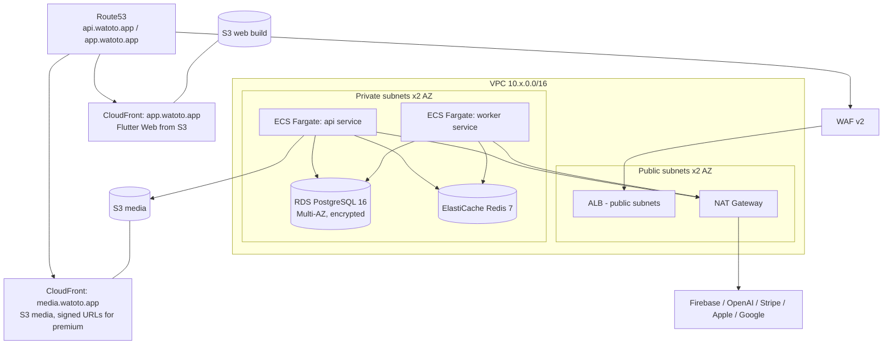

# 7. AWS Infrastructure Design

Three isolated accounts under an AWS Organization: `watoto-dev`, `watoto-staging`, `watoto-prod` (blast-radius isolation, per-account billing). All infra is Terraform (`infra/`), state in S3 + DynamoDB lock per account.

## 7.1 Topology (per environment)



## 7.2 Service Inventory

| Service | Config (prod / dev) |
|---|---|
| ECS Fargate `api` | 1 vCPU / 2 GB, min 2 max 20 tasks / dev: 0.5 vCPU, 1 task |
| ECS Fargate `worker` | 1 vCPU / 2 GB, min 1 max 8, scale on queue depth |
| RDS PostgreSQL 16 | prod: `db.r6g.large` Multi-AZ, 100 GB gp3 autoscale, PI on, 7-day PITR + daily snapshots 30d / dev: `db.t4g.small` single-AZ |
| ElastiCache Redis 7 | prod: `cache.r6g.large` ×2 (primary+replica) / dev: `cache.t4g.micro` |
| S3 | `watoto-media-<env>` (versioned, SSE-KMS), `watoto-web-<env>`, `watoto-uploads-<env>` (quarantine, 30-day lifecycle), `watoto-backups-<env>` |
| CloudFront | media distro: OAC to S3, signed URLs for premium packs; web distro: SPA fallback to index.html |
| Route53 | `watoto.app` zone; `api`, `app`, `media` records; ACM certs (us-east-1 for CF, regional for ALB) |
| WAF v2 | AWS managed core rule set, known-bad-inputs, rate rule 2000 req/5min/IP, geo log-only |
| Secrets Manager | per-env secrets, rotation lambda for DB creds (30d) |
| SES | transactional email (consent verification, reports) |
| CloudWatch | dashboards, alarms (§7.5), log groups 90d retention |

## 7.3 Networking & Security

- Private subnets have **no public IPs**; egress via NAT only. Security groups: ALB→api:3000 only; api/worker→RDS:5432, →Redis:6379; RDS/Redis accept from app SGs only.
- VPC endpoints (gateway: S3; interface: ECR, Secrets Manager, CloudWatch) to cut NAT cost and keep traffic private.
- ECS task roles are least-privilege per service (api cannot touch backups bucket; worker can).
- All data encrypted: KMS CMKs for RDS, S3, Secrets; TLS 1.3 at ALB and CloudFront (`TLSv1.2_2021` minimum policy).

## 7.4 Terraform Layout

```
infra/
├── modules/
│   ├── network/        # vpc, subnets, nat, endpoints
│   ├── ecs-service/    # task def, service, autoscaling, alarms
│   ├── rds/  redis/  s3-cdn/  waf/  secrets/  observability/
├── envs/
│   ├── dev/main.tf         # composes modules, small sizes
│   ├── staging/main.tf
│   └── prod/main.tf
└── global/                 # org, route53 zone, ECR repos, GitHub OIDC role
```

CI assumes a GitHub OIDC IAM role per environment (no long-lived AWS keys). `terraform plan` posts to PR; `apply` is gated by environment protection rules.

## 7.5 Alarms (prod)

| Alarm | Threshold → Action |
|---|---|
| ALB 5xx rate | >2% for 5 min → PagerDuty |
| API p95 latency | >800 ms for 10 min → PagerDuty |
| ECS running < desired | any → PagerDuty |
| RDS CPU / connections / storage | >80% / >85% max / <15 GB → page / warn |
| Redis memory | >75% → warn |
| BullMQ queue depth | >1000 for 15 min → warn |
| Billing webhook failures | >5/h → page (revenue impact) |
| AI spend (EMF metric) | >$X/day budget → warn + throttle flag |

## 7.6 Cost Estimate (prod, ~10k DAU, monthly USD ballpark)

| Item | Est. |
|---|---|
| Fargate (api 2–4 tasks + workers) | $180 |
| RDS r6g.large Multi-AZ + storage | $420 |
| ElastiCache r6g.large ×2 | $300 |
| NAT + data transfer | $120 |
| S3 + CloudFront (media-heavy) | $250 |
| WAF, Route53, Secrets, CloudWatch | $80 |
| **Subtotal infra** | **~$1,350** |
| OpenAI / STT / TTS (usage-capped) | $500–2,000 |

Dev+staging combined ≈ $250/mo (small instances, single-AZ, scheduled scale-to-zero for dev Fargate at night).
