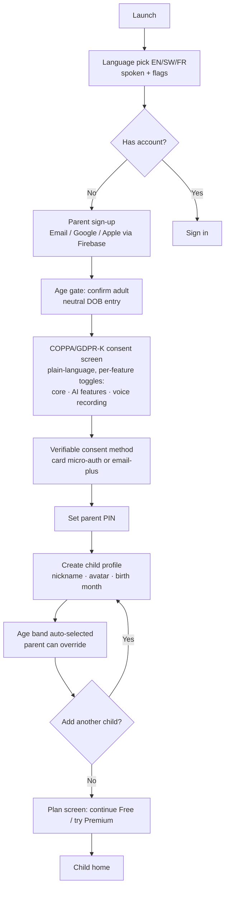
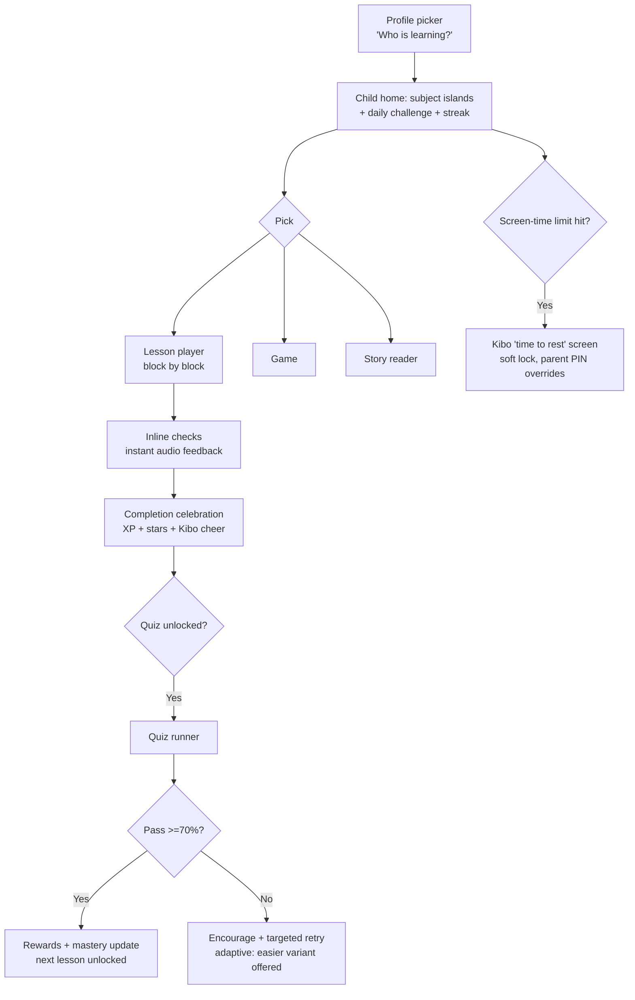
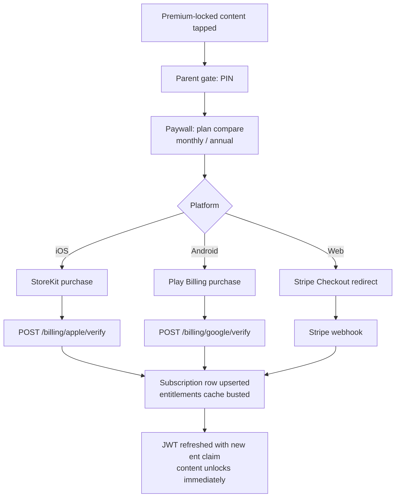
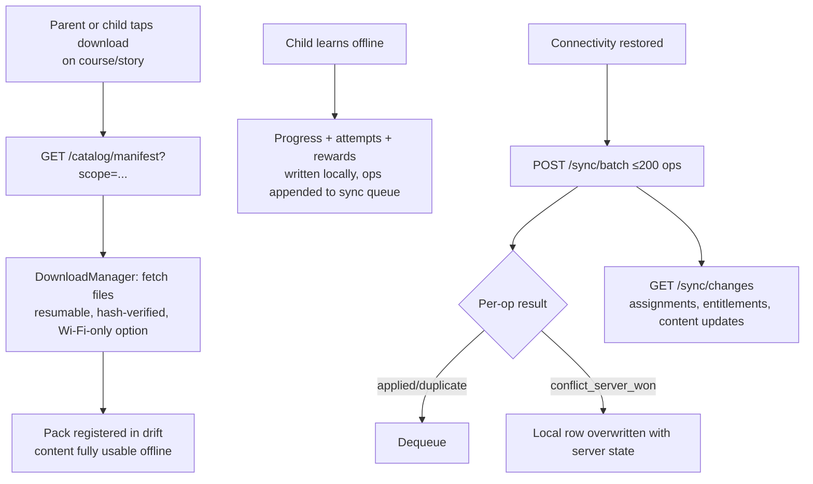

# 9. User Flows

## 9.1 First-Run Onboarding (Parent + Child Setup)

Key rules: child never enters personal data; consent is granular and revocable in Parent Zone; declining AI/voice consent simply hides those features.

## 9.2 Child Daily Learning Loop

## 9.3 Subscription Purchase

Restore purchases: Settings → "Restore" re-runs store verification. Cancellation/expiry arrives via ASSN v2 / RTDN / Stripe webhooks → grace period honored → entitlement downgrade.

## 9.4 Offline Download & Sync

## 9.5 Parent Dashboard Review

Parent → PIN → dashboard: per-child cards (streak, minutes, mastery deltas) → drill into subject report → weekly AI insight summary → actions: set goal, adjust screen time, approve leaderboard, manage subscription, export/delete data (compliance self-service).

## 9.6 Teacher Assignment Flow

Teacher (web/tablet) → create group → share join code → parent enters code in Parent Zone and approves linkage → teacher assigns lessons/quizzes with due date → children see "From your teacher" rail on home → teacher dashboard tracks per-child completion and class skill heatmap.

## 9.7 Reading Coach Session

Child opens story page → taps "Read it myself" → mic permission (parent pre-consented) → records page → upload via signed URL → async scoring (STT + alignment) → per-word feedback: green = good, amber = listen-and-retry with TTS model pronunciation → fluency stars awarded → recording auto-deleted ≤30 days, score retained.

## 9.8 Consent Revocation / Data Deletion

Parent Zone → Privacy → toggle consent off (AI/voice features hide immediately, server flag flips) or "Delete child profile" → confirm with PIN → soft-delete + 30-day grace (recoverable) → erasure job purges PII, recordings, and de-identifies analytics → email confirmation to parent.
