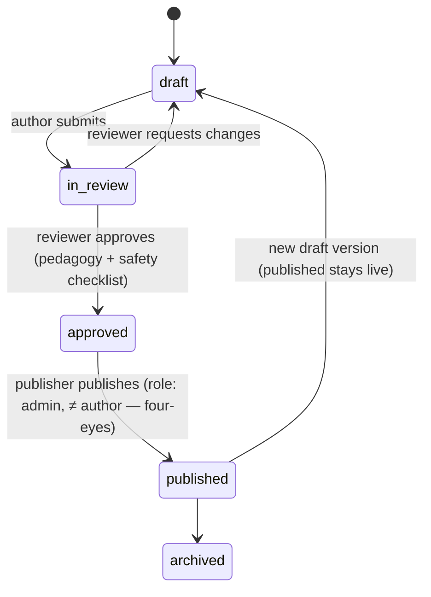

# 14. CMS Architecture

The Admin CMS is a **separate Flutter Web build target** (`apps/mobile` with `--dart-define=TARGET=cms`, sharing core widgets/clients) deployed to `cms.watoto.app`, talking to the same NestJS `/admin/*` API. Access: admin / super_admin roles + mandatory MFA (Firebase) + IP allowlist option via WAF.

## 14.1 Modules

| Module | Capabilities |
|---|---|
| **Dashboard** | Content health: missing translations, pending moderation, stale drafts, publish activity |
| **Curriculum Manager** | Tree view Subject→Course→Unit→Lesson; drag-reorder; age-band matrix view; bulk status ops |
| **Lesson Builder** | Block-based editor (one editor per block type), live device-frame preview, skill tagging, difficulty, premium flag |
| **Quiz Builder** | Question bank per quiz, 7 question types with type-specific editors, answer-key validation, preview-as-child |
| **Storybook Builder** | Page-by-page editor: text, illustration, narration upload/TTS, word-timing editor (auto-align + manual nudge) |
| **Flashcard Builder** | Deck editor, CSV bulk import, auto-TTS both sides |
| **Game Config** | Parameterize built-in engines (match/trace/sort/memory) per age band/subject |
| **Media Manager** | Upload (drag-drop) → virus scan → transcode (video → HLS ladders, audio → AAC, images → webp sizes) → moderation queue → tagged library with usage tracking ("where is this asset used?") |
| **Translation Manager** | Key matrix (key × locale × status), missing-translation filter, inline edit, XLIFF/CSV round-trip, TTS generation button, side-by-side source view |
| **Moderation Queue** | Pending items with diff context, approve/reject + notes, four-eyes rule for publish |
| **User Admin** | Search, suspend, role grants (admin grants = super_admin only), consent/audit views |
| **Platform Settings** | Feature flags, AI budget caps, plan pricing refs, maintenance banner (super_admin) |

## 14.2 Content Workflow



Publish side-effects (transactional + jobs): snapshot to `lesson_versions` (immutable, hashed) → rebuild affected `download_manifests` → bust Redis catalog caches → CDN warm → `ContentPublished` event → clients learn via `/sync/changes`.

**Safety invariant**: nothing reaches a child surface unless its status is `published` AND every referenced media asset is `moderation=approved` AND required-locale translations exist (or fallback rule explicitly set). Enforced by a DB-level publish check, not just UI.

## 14.3 Versioning & Rollback

Published versions are immutable; rollback = re-point `current_version_id` to a prior version (one click, audited). Draft editing never mutates the live version. Full edit history retained per entity (audit log diff trail).

## 14.4 Media Pipeline

```
upload (signed URL → uploads bucket/quarantine)
→ S3 event → media queue: ClamAV scan → reject or continue
→ transcode: video→HLS (480/720/1080) + poster; audio→AAC 64k; image→webp 1x/2x/3x + blurhash
→ copy to media bucket under content-hash key → media_assets row (moderation=pending)
→ moderation approval → usable in builders
```

## 14.5 Audit

Every `/admin/*` mutation writes `audit_logs` (actor, action, entity, before/after JSON diff, IP). Audit views are queryable in CMS by super_admin; logs are append-only and partition-archived to S3 Glacier after 12 months.
